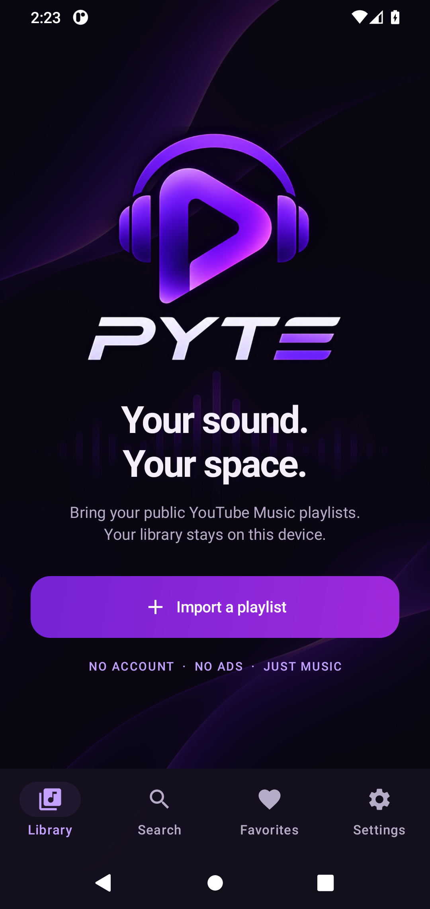
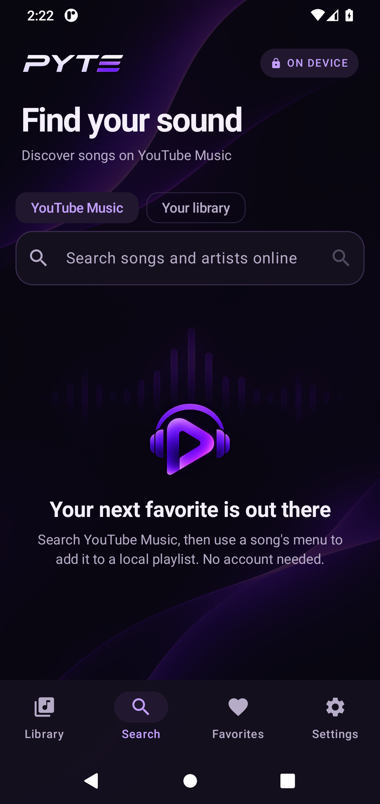

# PYTE

A local-first Android music player for public YouTube Music playlists.




- Paste a public playlist link once. No account, no login.
- Plays audio directly, so there are no ads.
- Plays in the background through a foreground media service, with lock-screen and notification controls.
- All data stays on the device (Room database, on-device stream cache).
- Rename and refresh playlists without losing local names or favorites; deletion asks for confirmation.
- Search titles and artists locally with Unicode-aware full-text prefix matching.
- Search YouTube Music songs online, load more results, and save songs to existing local
  playlist copies or create a new on-device playlist. YouTube account playlists are never modified.
- Locally added tracks survive refreshes from YouTube; adding the same song twice is prevented.
- Add songs next/later, open the queue from Now Playing, move entries up/down, or remove them.
- Recently played songs are recorded locally only after playback starts.
- Settings: skip silence, enable/disable history recording, clear history with confirmation,
  and view app/privacy information. Preferences are stored locally with DataStore.
- Mark individual library playlists **Available offline**. Downloads run only on unmetered Wi-Fi,
  are resumable when the server supplies a validator, and are shared across selected playlists.
  Completed audio plays locally without resolving a YouTube URL, even after restarting offline.
- Settings show offline storage usage, a configurable limit (2 GB initially), and pause/resume.
  Reaching the limit pauses downloads; it never evicts selected songs. Deselecting/deleting a
  playlist releases files only when no other offline playlist needs them.
- Now Playing → **Lyrics**: synchronized LRCLIB lyrics with tap-to-seek, animated highlighting,
  cover backdrop and subtle waves. Plain text/instrumental/missing lyrics have explicit states.
  Available lyrics and cover artwork are pinned alongside offline audio. Lyrics requests send
  title, artist and duration to LRCLIB; the app identifies itself and respects rate limiting.
- Artwork requests size-appropriate high-resolution variants with original-image fallback,
  including songs already stored in the library. Image disk cache is capped at 96 MB.
- Cover resizing includes YouTube Music's `yt3.googleusercontent.com` host. Offline covers
  are checked by decoded dimensions and upgraded on unmetered Wi-Fi without downloading
  audio again. Failed/low-resolution upgrades are rate-limited to one check per day per song.
- Dynamic cover colors animate across Now Playing, Lyrics and the mini-player. Settings can
  turn this off; the library retains its violet theme. Palette sampling is local, bounded and
  uses pinned artwork offline, with a violet fallback for missing/grayscale art.
- A session-scoped native equalizer is available from the player, Lyrics and Settings. It uses
  the output's supported bands, five presets, and up to 12 named local sound profiles. Curves
  are adapted by frequency when the audio session/output changes. Boosts reserve volume
  headroom (not a clipping limiter); unsupported effects/outputs are shown explicitly.

Android cloud backup and automatic device transfer are disabled. Keep the app installed when
updating APKs: uninstalling or clearing app storage removes your local library and downloads.
Manual library export is not implemented yet.

**0.2.0-alpha.4 signing change:** the previous signing key is unavailable. This APK cannot
update earlier releases in place: uninstalling the old app is required and deletes its local
library and settings. This exception takes precedence over the normal update advice above.

> Personal use only. Extracting streams is against YouTube's Terms of Service. Do not publish this app to the Play Store or run it as a public service.

## Build

Requirements: JDK 17, Android SDK with platform 37.0 and build-tools 37.0.0.

```bash
./gradlew :app:assembleDebug     # app/build/outputs/apk/debug/app-debug.apk
./gradlew :app:testDebugUnitTest
```

Signed release builds: copy `keystore.properties.example` to `keystore.properties` and point it at your keystore. Without it, `assembleRelease` uses the debug key.

## Architecture

| Layer | Path | Notes |
|---|---|---|
| UI | `ui/` | Jetpack Compose, Material 3, dark only |
| Playback | `playback/` | `PlaybackService` (Media3 `MediaSessionService`) owns ExoPlayer. The UI only sends commands through a `MediaController`. |
| Extraction | `data/remote/` | Anonymous visitor bootstrap + `VISIONOS` player, with `ANDROID_VR` / `IOS` fallbacks. `WEB_REMIX` playlist browsing and song search with continuation tokens. |
| Storage | `data/local/` | Room: playlists, tracks, playlist order, favorites, history, FTS4 search |
| Cache | `di/AppModule.kt` | Media3 `SimpleCache`, LRU, 1.5 GB |
| Offline | `data/offline/` | WorkManager, Wi-Fi-only, atomic app-private files; Room selection and progress |
| Lyrics | `data/lyrics/` | LRCLIB, bounded cache + pinned offline lyrics, LRC parser |

Stream URLs are resolved lazily, when the player requests bytes, and cached until shortly before their `expire` time. A one-byte range probe checks audio access before selecting a client; if it fails, the resolver tries the next client. Each stream uses its originating client's User-Agent. Late HTTP 403/410 responses temporarily exclude that client during recovery. Audio cache keys include the format ID so fallback cannot mix different encodings.

The preferred player first obtains an anonymous visitor identifier from YouTube, keeps it in memory,
and uses a fresh playback nonce for each player request and its audio URLs. No account login or
account cookies are involved. This remains an unofficial API: successful tests do not guarantee
access to every track, region, network, or future YouTube version.

See [CHANGELOG.md](CHANGELOG.md) and [TESTING.md](TESTING.md) for changes and verification limits.

## Current development phase

Phase 4 adds library management, a local FTS4 index, history, and queue editing using
accessible move buttons (not drag-and-drop). Settings, online song search, and local playlist
additions extend that baseline. The database migrates from versions 1/2 to 3 without
destructive fallback; tests cover pre-existing playlists, order, favorites, history and local additions.
Offline playlist downloads, storage controls, high-resolution artwork and animated lyrics extend
this baseline. Longer-running device resilience checks remain necessary. The database migrates
from versions 1/2/3 to 4 without destructive fallback.

To add a song: **Search → YouTube Music → enter a title/artist → press Search → song menu
→ Add to local playlist**. Choose an existing playlist or enter a new local playlist name.
The search uses YouTube Music's unofficial service; region, age, account restrictions and
future upstream changes can affect results and playback. Finding a song does not guarantee playback.

The violet design and original-logo asset pipeline are documented in [docs/DESIGN.md](docs/DESIGN.md).
