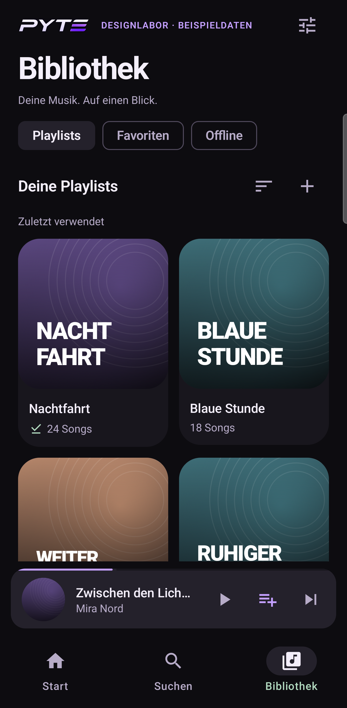
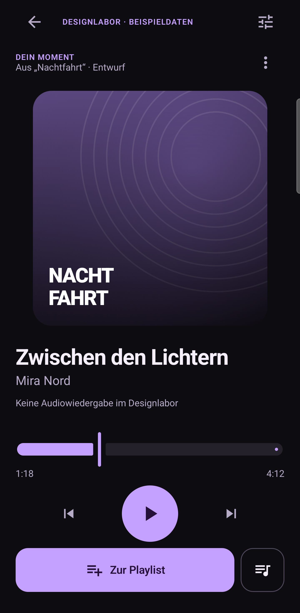
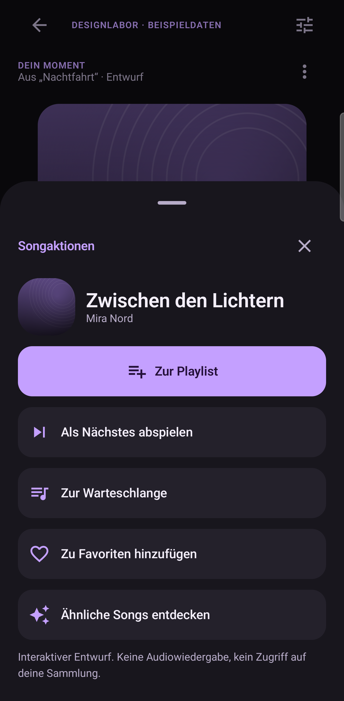

# PYTE Listening Space — milestone 1 design candidate

This is a reviewable **design candidate**, not a replacement music player. The existing
production theme and installed `dev.pyte` application remain unchanged pending approval.

## Direction and skill review

The UI/UX and design-system skills were used to review native touch targets, Compose state
and stable list keys, and primitive → semantic → component token layering. Their generated
website showcase sections, hover advice, green play branding and web font imports were not
adopted. This is a native, violet PYTE design, not a landing page. No OLED/battery savings are
claimed from the palette.

- Charcoal surfaces separate content without placing a translucent card behind every label.
- Lavender marks primary interaction; mint marks offline/saved status; errors have their own role.
- Artwork is prominent, but controls and text remain readable without artwork-derived colors.
- System sans-serif typography keeps Android text scaling; no network font loading.
- German labels, visible close/back controls and explicit playlist saving remain fundamental.

## Code source of truth

`app/src/main/java/dev/pyte/ui/theme/ListeningDesign.kt` contains candidate tokens. Production
`PyteTheme` is deliberately not switched to these tokens yet.

| Layer | Definition | Purpose |
| --- | --- | --- |
| Primitive | `ListeningPalette`, 4 dp spacing unit | Raw colors and scale |
| Semantic | `ListeningDesign.colors/type`, `ListeningSpace` | Surfaces, text, primary/error roles, rhythm |
| Component | `ListeningComponents`, `ListeningMotion` | 48 dp targets, 56 dp buttons, common shapes, finite timing |

Content inset is 20 dp, item spacing 12 dp, section spacing 24 dp. Labels and controls use the
same roles across library, player and action sheet. Press/content/expansion timings are
140/240/360 ms starting points, always gated by the existing motion policy. Artwork graphics
are static local vectors, not audio visualizations or an idle animation loop.

## Review scenes

1. **Bibliothek:** compact useful heading, Playlists/Favoriten/Offline filters, readable grid
   cards, sort/new actions, persistent mini-player and labelled Start/Suchen/Bibliothek navigation.
   A collection opens its detail view rather than unexpectedly playing or opening song actions.
2. **Player:** artwork and metadata above the transport; save and queue remain visible below.
   The artwork region scrolls on compact/large-text layouts rather than pushing primary controls
   off-screen. The time/progress/play state is simulated and explicitly labelled as such.
3. **Songaktionen:** song identity first, prominent Zur Playlist, then next/queue/favorite/discovery.
   Picker search and membership status are simulated in memory. Back returns to actions when
   entered from there; Close exits the flow. Saving/undo affects demo data only.

Start, local sample search, collection detail, queue and new-playlist dialogs exist to make
navigation inspectable. They are not claims that milestone-2 production workflows are complete.

## Isolation

Build type `designReview` uses package **`dev.pyte.designreview`** and label **PYTE Designlabor**.
The manifest replaces `PyteApp` with a plain `Application`, removes the production launcher,
playback service and startup provider, and removes internet, wake-lock, boot and notification
permissions. No production controller, repository or database is instantiated by the review UI.
All songs, artwork and collections are fictional fixtures. Counts, play state and queue changes
are visual simulations; there is no audio output. The app always identifies itself as a design
laboratory. No design-review APK should be published as the normal PYTE release.

The large-text and reduced-animation review options are **local to this app**. They do not
change the user's phone font scale, system animations, battery settings or music preferences.

## Build and inspect

```bash
./gradlew :app:assembleDesignReview :app:lintDesignReview
adb install -r app/build/outputs/apk/designReview/app-designReview.apk
adb shell am start -n dev.pyte.designreview/dev.pyte.designreview.DesignReviewActivity
```

The activity supports `--es page library|player|actions`, `--es state normal|loading|empty|error`,
`--ez largeText true`, and `--ez reducedMotion true` for repeatable screenshots. These flags
select review fixtures only. Standard debug/release builds do not include the review activity
or review-only strings/fixtures.

Dedicated device checks target the isolated app:

```bash
./gradlew -PpyteTestBuildType=designReview :app:connectedDesignReviewAndroidTest \
  -Pandroid.testInstrumentationRunnerArguments.class=dev.pyte.ui.DesignReviewUiTest
```

With that property, the unit-test task is `testDesignReviewUnitTest`. The default configuration
continues to use `testDebugUnitTest`; don't request the debug unit task in the review-only
test configuration.

The phone must be unlocked. Tests do not unlock a protected device, clear the music app,
change global font settings, or access the real collection. Captures are written inside the
review package's external-files `design-review` directory. Results and screenshot review are
recorded separately; a screenshot is not evidence of real audio playback or battery savings.

## Approval gate

Approve or adjust these three scenes before migrating the live app/navigation. Membership
queries, bulk operations, richer production queue editing and measured performance/battery
work belong to subsequent milestones, not this visual prototype.

## Device captures and review

Captured on the connected Galaxy S25 Ultra (SM-S938B), Android 17 / API 37, physical
1440×3120 display at 600 dpi. The images below contain fictional review data only. The system
status/navigation areas were cropped on-device to avoid including personal ongoing-activity
labels; the application layout and colors were not retouched. Samsung's edge-panel handle
can still appear at the right edge.

| Bibliothek | Player | Songaktionen |
| --- | --- | --- |
|  |  |  |

Additional captures: [picker](screenshots/s25-ultra/picker.png),
[160% text / reduced motion](screenshots/s25-ultra/player-large-text.png),
[loading](screenshots/s25-ultra/library-loading.png),
[empty](screenshots/s25-ultra/library-empty.png),
[error](screenshots/s25-ultra/library-error.png).

Five dedicated instrumentation tests passed on the physical device: representative views,
demo save/undo, picker search/back, large-text control reachability, and loading/empty/error
recovery. The initial review caught broken decorative cover lettering; it was fitted to its
available width and recaptured. Initial automation failures exposed a cross-window test-tag
boundary and an incorrect keyboard assumption; those tests were corrected and the final run
passed all five cases. These results qualify the candidate scenes, not the live music player.

The production `dev.pyte` package remained at alpha.12/versionCode 16 with its original install
path. No replacement APK was installed over it. Phone font scale remained 1.0; 160% text is
simulated locally in the review app. TalkBack, landscape, live playback, end-to-end production
flows and power/frame-time benchmarks are still open.
